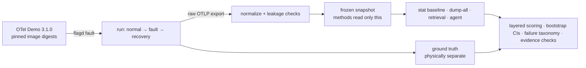

# Incident Investigator

[](https://github.com/jingwenliu0113-afk/incident-investigator/actions/workflows/ci.yml)

> **Status (November 2026): complete.** Gate **NOT PASSED** with the frozen local model; an exploratory rerun with Gemini 4 Argon is reported separately and does not change the decision. No further experiments are planned.
>
> **狀態（2026 年 11 月）：已完成。** 以凍結的本機模型判定 Gate **NOT PASSED**；Gemini 4 Argon 的探索性重跑另外報告，不改變判定。不再進行新的實驗。

**Can an LLM agent find the root cause of a production incident from a frozen telemetry snapshot, and beat simple baselines?**

[English](#english) · [中文](#中文)

---

## English

This is a pre-registered evaluation built on the [OpenTelemetry Demo](https://github.com/open-telemetry/opentelemetry-demo) (a microservice shop).

The pipeline:

1. Inject one of 10 faults.
2. Record traces, logs and metrics.
3. Freeze each incident into a read-only snapshot.
4. Ask four methods to name the fault, the origin service, the affected services and the user-facing symptom.

Pass or fail is decided by a Gate that was written down before any held-out data existed.

### Result

**Gate: NOT PASSED.** On 50 held-out incidents, the LLM methods used the frozen local model (qwen3.5 9B). The agent did not beat the statistical baseline at finding the origin service:

- agent 0.58 vs baseline 0.66 (origin top-1);
- paired difference −0.08, 95% CI [−0.28, 0.12].

An **exploratory** rerun swapped in Gemini 4 Argon, keeping everything else the same: same incidents, prompts, tools and budgets. Every LLM method improved a lot (agent origin top-1 0.82). The agent's lead over the baseline was still not significant: +0.16, 95% CI [0.00, 0.32]. That rerun is reported separately and does not change the Gate decision.

| method (held-out, n = 50) | fault type | origin top-1 | affected F1 | symptom exact |
|---|---:|---:|---:|---:|
| statistical baseline | 0.32 | 0.66 | 0.80 | 0.40 |
| retrieval + LLM (qwen 9B) | 0.48 | 0.62 | 0.81 | 0.50 |
| dump-all + LLM (qwen 9B) | 0.46 | 0.72 | 0.74 | 0.46 |
| agent + 7 tools (qwen 9B) | 0.48 | 0.58 | 0.70 | 0.46 |
| *retrieval + LLM (Argon, exploratory)* | *0.88* | *0.86* | *0.88* | *0.74* |
| *dump-all + LLM (Argon, exploratory)* | *0.90* | *0.84* | *0.88* | *0.76* |
| *agent + 7 tools (Argon, exploratory)* | *0.94* | *0.82* | *0.86* | *0.76* |

What the numbers say:

- **A small local model did not beat a statistical baseline at locating the origin service.**
- **A stronger model lifts every LLM method.** But the agent is no better than the simpler pipelines: with Argon, retrieval reaches 0.86 and dump-all 0.84 on origin top-1.
- **Most of Argon's remaining errors are "seen but misread".** In those incidents the method's exposure log (the record of what it was shown) had at least one entry that counts as seeing the origin service under a loose definition of "seen": a record of the origin from the fault window, any of the origin's metric series, or per-minute statistics that cover the origin in the fault window (decision 022; see [Limitations](#limitations), point 2). One example: on the payment-unreachable fault, the agent found the right origin in 1 of 5 incidents; the baseline found it in 5 of 5 (that fault's origin is a labeling convention; see Limitations, point 1).
- Negative results are reported in full. No metric, split or protocol was changed after results were seen.

Full reports:

- [held-out results](https://github.com/jingwenliu0113-afk/incident-investigator/blob/main/docs/decisions/100-heldout-final-results.md)
- [wrap-up decision](https://github.com/jingwenliu0113-afk/incident-investigator/blob/main/docs/decisions/031-heldout-wrap-up.md)
- [exploratory Argon results](https://github.com/jingwenliu0113-afk/incident-investigator/blob/main/docs/decisions/101-exploratory-argon-results.md)

### How it works



- **Controlled data.** The OpenTelemetry Demo runs from pinned image digests.
  - There are 10 faults across 7 fault types: error responses, an unreachable dependency, added latency, lock contention, CPU load, GC pauses and memory leaks.
  - Raw OTLP is exported with loss accounting, then normalized into a canonical snapshot.
  - Fault flags and harness traces are removed before a snapshot is published, and a leakage audit grades each incident easy, medium or hard.
- **No peeking.** Methods only ever read the frozen snapshot, never a live system. Labels sit in a separate directory that the methods cannot read.
- **Four methods with one output schema.**
  - A statistical anomaly baseline.
  - *dump-all*: pack the snapshot into the context.
  - *retrieval*: query first, then answer.
  - A tool-using agent with 7 read-only tools and budgets on tool calls, tokens and turns.
- **Evaluation.**
  - Layered metrics that are never merged into one score: fault type, origin top-1 and top-3, affected-service F1, and user symptom.
  - Run-group cluster bootstrap CIs and paired comparisons.
  - A failure taxonomy: no answer, coverage, mechanism, not seen, seen but misread, rule limit.
  - Evidence checks: does each citation exist, weak labels, and a method-blind human gold standard.
- **Pre-registration.**
  - The Pilot set (10 incidents) is kept apart from the held-out set (50 incidents).
  - A freeze record keeps code, prompts and model byte-identical during the held-out runs.
  - Each method runs once per incident.
  - Every design change is written in a [decision log](https://github.com/jingwenliu0113-afk/incident-investigator/tree/main/docs/decisions) (42 records).
- **Engineering.** Python with `uv` and over 1,100 automated tests, written test-first. Local inference ran on an RTX 5070 Ti desktop through Ollama; the exploratory run used Vertex AI.

### Limitations

The numbers below come from the decision records named in each point.

1. **The paymentUnreachable origin is a labeling convention.** The fault makes checkout call a wrong payment address while payment itself stays healthy, so the label names checkout as the origin (decision 016 §1). In both runs the agent found that origin in 1 of 5 incidents and the baseline in 5 of 5 (decisions 100 §5, 101 §5). Leaving this one fault out of the Argon comparison, the lower bound of the agent's lead over the baseline rises from 0.00 to 0.13; no other fault lifts it above 0 (decision 101 §5).
2. **"Seen" is defined loosely.** A wrong origin counts as "seen but misread" when the method's exposure log has any record of the origin service from the fault window (a normal-looking one counts too), any of the origin's metric series, its per-minute statistics for a fault minute, or the per-minute overview given to retrieval and dump-all, which covers every service (decision 022 §2 and its known limitations). So retrieval and dump-all have no "not seen" failures in these results (decisions 100 §7, 101 §7).
3. **The agent often ran out of budget.** The qwen agent reached a limit in 15 of 50 incidents (12 then submitted, 3 stopped at the turn limit). The Argon agent, which often called several tools in one reply, submitted after reaching a limit in 25 of 49 (decisions 100 §9, 101 §9). Both runs used the same budgets: 40 tool calls, 120,000 proxy tokens and 30 turns (decision 032 §2).
4. **Power is limited.** Before any held-out data existed, the protocol estimated about 0.74 power for a true difference of 0.20 in origin top-1, simulated with one method right and the other wrong in 30% of incidents (decision 023 §2). In the Gate run, the agent and the baseline had one right and the other wrong on origin top-1 in 28 or 30 of the 50 incidents, more often than assumed (the range the per-fault table in decision 100 §5 allows; decision 040 shows the count), and Argon's lead (+0.16, decision 101 §5) is smaller than 0.20. A difference that is not significant here does not show that the methods are equal.
5. **No fault-free control, and one annotator.** Every incident has an injected fault, so false alarms are not measured. One person reviewed the labels and made the evidence judgments; the judgments were blind to the method but not to the ground truth (decisions 031, 100 §8 and 017).
6. **Leftover fault text and public scenarios.** The productCatalogFailure snapshots keep a residue of the injected error message (for example `Product Catalog Fail Enabled`), accepted in decisions 011 and 016. Methods that read the snapshot's text (the three LLM methods; the statistical baseline uses only per-minute statistics) can see it, so their results on this fault may be better than they would be without it; this evaluation does not measure that. The OpenTelemetry Demo and its fault flags are public, so the models may already know these scenarios; this evaluation does not test for that either.

### Try it

The demo reads a small synthetic incident. It needs no Docker and no model, and its scores are not results.

```bash
uv sync
uv run python -m eval demo
```

The tests also read the pinned OpenTelemetry Demo source. `env fetch-upstream` makes a shallow clone of the pinned tag and checks its commit; it needs no Docker.

```bash
uv run python -m env fetch-upstream
uv run pytest -q -m "not network and not docker_daemon"
```

Real incident snapshots (several GB of telemetry) are not in git. Only the synthetic sample in [`data/samples/synthetic/`](https://github.com/jingwenliu0113-afk/incident-investigator/tree/main/data/samples/synthetic) is.

### Repository map

| path | what |
|---|---|
| `SPEC.md` | research question, scope, Gate |
| `env/` | version locks, soak tests, machine locks |
| `collect/` | fault runs, normalization, labels, human review, held-out freeze |
| `baselines/` | statistical, dump-all and retrieval methods |
| `agent/` | agent tools, harness, model adapters (Ollama; Gemini on the exploratory branch) |
| `eval/` | scoring, bootstrap, comparison, Gate, failure taxonomy, evidence relevance |
| `schemas/` | JSON schemas for snapshots, labels, predictions and manifests |
| `docs/decisions/` | every design decision and the result reports |
| `tests/` | unit and integration tests |

The root `README.md` is the working document frozen at the held-out freeze (decision 037 explains why this page is in `.github/`). The exploratory Gemini code lives on branch `explore/032-argon`.

### How this was built

The code was written with [Claude Code](https://claude.com/claude-code), Anthropic's coding agent, and commits are marked `Co-Authored-By: Claude`.

My part (Jingwen Liu):

- set the research question and the pass/fail criteria;
- approved every design decision in the log;
- reviewed every incident label by hand;
- made about 1,200 method-blind evidence relevance judgments;
- decided how to close the project after the Gate failed.

### License

Code is MIT-licensed ([LICENSE](https://github.com/jingwenliu0113-afk/incident-investigator/blob/main/LICENSE)). The OpenTelemetry Demo (Apache-2.0) is only referenced by image digest, not copied.

---

## 中文

**LLM Agent 能不能只靠一份凍結的 telemetry snapshot 找出 production 事故的根因，而且勝過簡單的 baseline？**

這是在 [OpenTelemetry Demo](https://github.com/open-telemetry/opentelemetry-demo)（微服務電商範例）上做的事前登記評測。流程：

1. 注入 10 個故障之一。
2. 收集 traces、logs、metrics。
3. 把每個事故凍結成唯讀的 snapshot。
4. 讓四種方法判斷故障類型、根源服務、受影響服務與使用者症狀。

成敗由 held-out 資料出現之前就寫好的 Gate 判定。

### 結果

**Gate：NOT PASSED。** 在 50 個 held-out 事故上，LLM 方法用凍結的本機模型（qwen3.5 9B）。Agent 找根源服務沒有勝過統計 baseline：

- origin top-1 是 0.58，baseline 是 0.66；
- 配對差異 −0.08，95% 區間 [−0.28, 0.12]。

**探索性**重跑把模型換成 Gemini 4 Argon，其他完全相同：同樣的事故、prompt、工具與預算。三個 LLM 方法都大幅進步（agent 的 origin top-1 是 0.82），但 agent 領先 baseline 仍不顯著：+0.16，95% 區間 [0.00, 0.32]。這次重跑另外報告，不改變 Gate 判定。數字見上方英文版的表。

重點：

- **小型本機模型找根源服務沒有勝過統計 baseline。**
- **換成較強的模型，每個 LLM 方法都進步。** 但 agent 沒有比簡單的做法好：用 Argon 時，retrieval 的 origin top-1 是 0.86、dump-all 是 0.84。
- **Argon 剩下的錯誤大多是「看過但判讀錯」**：這些事故裡，方法的 exposure 紀錄（方法看過哪些資料）至少有一項依偏寬的「看過」定義算作看過 origin 服務：origin 在故障期間的紀錄、origin 的任何一條 metric series，或涵蓋 origin 故障期間的每分鐘統計（decision 022，見[限制](#限制)第 2 點）。例如 payment 連不上的故障，agent 5 次只找對 1 次根源，baseline 5 次都對（這個故障的 origin 是 label 的慣例，見限制第 1 點）。
- 負面結果完整報告。看到結果之後，沒有修改任何指標、資料切分或評測流程。

完整報告：

- [held-out 結果](https://github.com/jingwenliu0113-afk/incident-investigator/blob/main/docs/decisions/100-heldout-final-results.md)
- [收尾決定](https://github.com/jingwenliu0113-afk/incident-investigator/blob/main/docs/decisions/031-heldout-wrap-up.md)
- [Argon 探索性結果](https://github.com/jingwenliu0113-afk/incident-investigator/blob/main/docs/decisions/101-exploratory-argon-results.md)

### 做了什麼

- **可控的資料**：
  - OpenTelemetry Demo 以 image digest 鎖定版本；10 個故障，分屬 7 種故障類型：錯誤回應、依賴連不上、延遲、鎖爭用、CPU、GC、記憶體洩漏。
  - raw OTLP 匯出時計算資料遺失，再 normalize 成標準 snapshot。
  - 發布前移除故障旗標與測試痕跡；leakage audit 把每個事故分成 easy / medium / hard。
- **不偷看**：方法只讀凍結的 snapshot，不碰運作中的系統；標準答案放在方法讀不到的另一個目錄。
- **四種方法，同一種輸出格式**：
  - 統計異常 baseline；
  - dump-all：把資料塞進 context；
  - retrieval：先查詢再回答；
  - 帶 7 個唯讀工具的 agent，工具呼叫、token、回合都有預算。
- **評測**：
  - 分層指標，不合成一個分數；
  - run-group cluster bootstrap 區間與配對比較；
  - 失敗分類（沒看過、看過但判讀錯…）；
  - evidence 檢查：引用是否存在、弱標籤、方法盲標的人工 gold。
- **事前登記**：
  - Pilot（10 個事故）與 held-out（50 個事故）分開；
  - held-out 執行期間用 freeze 紀錄鎖住程式、prompt 與模型；
  - 每個方法每個事故只跑一次；
  - 所有設計變更都寫進 [decision log](https://github.com/jingwenliu0113-afk/incident-investigator/tree/main/docs/decisions)（42 份）。
- **工程**：Python 加 `uv`，1,100 個以上的自動測試，先寫測試再寫程式。本機推論在 RTX 5070 Ti 桌機（Ollama）上跑，探索性重跑用 Vertex AI。

### 限制

以下的數字都來自各點標明的 decision。

1. **paymentUnreachable 的 origin 是 label 的慣例。** 這個故障讓 checkout 呼叫錯誤的 payment 位址，payment 本身是健康的，所以 label 把 origin 定為 checkout（decision 016 §1）。兩次執行中，agent 都是 5 次只找對 1 次這個 origin，baseline 5 次都對（decision 100 §5、101 §5）。Argon 的比較拿掉這一個 fault，agent 領先 baseline 的下界就從 0.00 變成 0.13；拿掉其他任何一個 fault，下界都不會大於 0（decision 101 §5）。
2. **「看過」的定義偏寬。** origin 答錯時，只要方法的 exposure 紀錄裡有 origin 服務在故障期間的任何紀錄（看起來正常的也算）、origin 的任何一條 metric series、origin 在故障期間的每分鐘統計，或 retrieval 與 dump-all 拿到的每分鐘概覽（涵蓋所有服務），就算「看過但判讀錯」（decision 022 §2 與「已知限制」）。所以在這些結果裡，retrieval 與 dump-all 沒有任何「沒看過」的失敗（decision 100 §7、101 §7）。
3. **agent 常用完預算。** qwen agent 50 題中有 15 題撞到上限（12 題之後提交、3 題停在回合上限）；Argon agent 一次回覆常平行呼叫多個工具，49 題中有 25 題在用完預算之後才提交（decision 100 §9、101 §9）。兩次執行的預算相同：40 次工具呼叫、120,000 proxy tokens、30 回合（decision 032 §2）。
4. **檢定力有限。** 在任何 held-out 資料出現之前，協定估計 origin top-1 的真實差異 0.20、30% 的事故一方答對另一方答錯時，Gate 的 power 約 0.74（decision 023 §2）。正式執行（qwen）時，agent 與 baseline 在 origin top-1 一方答對、另一方答錯的事故，50 個中有 28 或 30 個，比假設的多（decision 100 §5 的各 fault 表所允許的範圍，算法見 decision 040）；Argon 的領先 +0.16（decision 101 §5）也小於 0.20。這裡的「不顯著」不代表兩種方法一樣好。
5. **沒有無故障的對照，也只有一位標註者。** 每個事故都注入了故障，所以沒有量到誤報。label 的 review 與 evidence 的判定都由同一個人完成；判定時看不到是哪個方法，但看得到標準答案（decision 031、100 §8、017）。
6. **注入的殘字與公開的故障情境。** productCatalogFailure 的 snapshot 留有注入錯誤訊息的殘字（例如 `Product Catalog Fail Enabled`），decision 011、016 已接受。讀 snapshot 文字的方法（三個 LLM 方法；統計 baseline 只用每分鐘統計）看得到它，所以它們在這個 fault 的結果可能比沒有殘字時好；本評測沒有量這個影響。OpenTelemetry Demo 與它的故障旗標都是公開的，模型可能事先就知道這些情境；本評測也沒有檢查這一點。

### 試跑

demo 只讀一個小型的合成事故，不需要 Docker 和模型，分數也不是結果。測試還需要鎖定版本的 OpenTelemetry Demo 原始碼：先跑 `uv run python -m env fetch-upstream`（淺層 clone 鎖定的 tag 並核對 commit，不需要 Docker）。指令見上方英文版的「Try it」。真實事故的 snapshot 不進 git。

### 怎麼做出來的

程式由 [Claude Code](https://claude.com/claude-code)（Anthropic 的 coding agent）撰寫，commit 標記 `Co-Authored-By: Claude`。

我（Jingwen Liu）負責的部分：

- 訂定研究問題與成敗標準；
- 批准 decision log 裡的每一個設計決策；
- 人工 review 每個事故的 label；
- 完成約 1,200 筆方法盲標的 evidence 相關性判定；
- 在 Gate 沒有通過後決定如何收尾。

### 授權

程式碼以 MIT 授權（[LICENSE](https://github.com/jingwenliu0113-afk/incident-investigator/blob/main/LICENSE)）。OpenTelemetry Demo（Apache-2.0）只以 image digest 引用，沒有複製它的程式碼。
